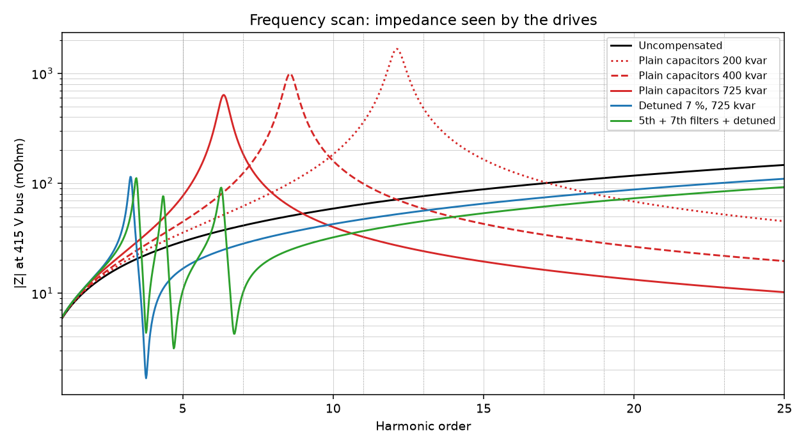
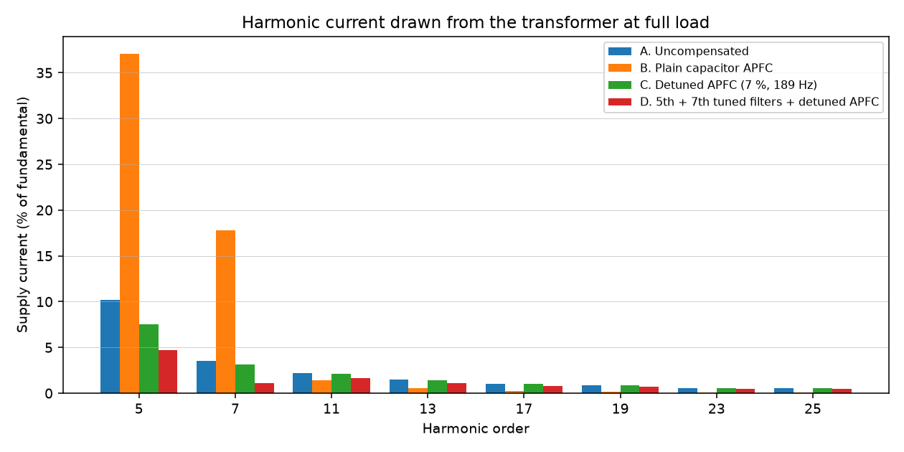
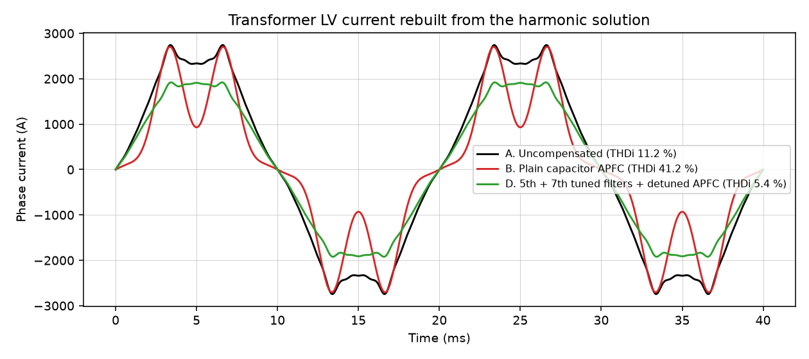
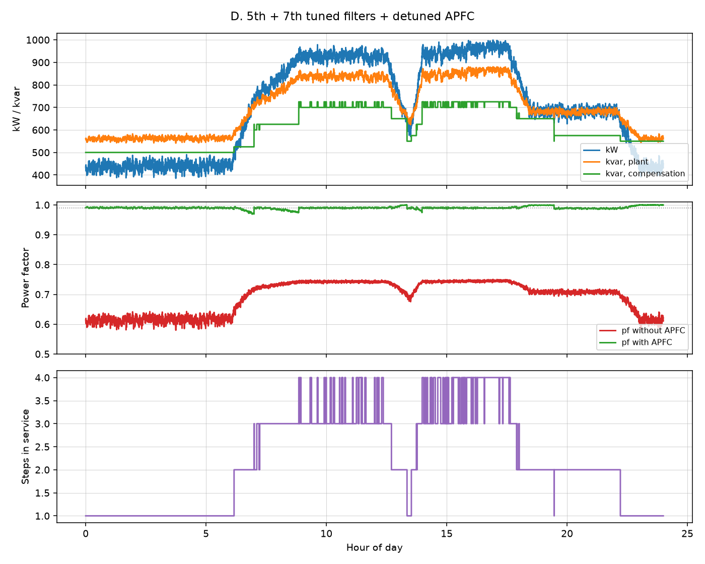

# Automatic Power Factor Correction & Harmonic Mitigation

A 415 V plant bus fed from a 1600 kVA, 11/0.433 kV transformer carries 550 kW
of direct-on-line motors and 450 kW of six-pulse drives. At full load it runs
at **pf 0.75 lagging**, and over a typical day it averages 0.70.

This project sizes the APFC panel and simulates the relay through a full day. It
then works through the problem that comes with it: capacitors on a bus with
drives form a parallel resonance with the supply. Four arrangements are compared
in a harmonic penetration study against IEEE 519-2022, with capacitor duty
checked to IEEE 18:

| | Arrangement |
|---|---|
| A | no compensation |
| B | plain capacitor APFC |
| C | detuned APFC (7 % reactors, tuned to 189 Hz) |
| D | fixed 5th and 7th single-tuned filters plus a smaller detuned APFC |

## Running

```bash
pip install -r requirements.txt
python study.py
python -m pytest
```

Results go to `results/apfc_harmonics.xlsx` and the plots in `results/`.

## Results

### Harmonics at full load (1000 kW)

| | Compensation | Displacement pf | True pf | THDv 415 V | TDD 415 V | IEEE 519 at 415 V | TDD limit at 11 kV PCC | Meets it |
|---|---|---|---|---|---|---|---|---|
| A. Uncompensated | - | 0.750 | 0.746 | 3.96 % | 11.2 % | fails (limit 5 %) | 15 % | yes |
| B. Plain capacitors | 750 kvar | 0.992 | 0.917 | **9.38 %** | **41.2 %** | fails | 15 % | **no** |
| C. Detuned 7 % | 750 kvar | 0.992 | 0.988 | 2.54 % | 8.7 % | just fails (limit 8 %) | 15 % | yes |
| D. Filters + detuned | 750 kvar | 0.992 | **0.990** | **1.78 %** | **5.4 %** | **meets** | 15 % | yes |

- **Plain capacitors make things much worse.** With 725-750 kvar on a 23.9 MVA bus,
  the parallel resonance lands at about the 6th harmonic, right between the 5th
  and 7th that the drives inject. The 5th bus voltage rises from 2.8 % to 7.8 % and
  the 7th from 1.4 % to 5.2 %, and the transformer's current TDD goes from 11 % to 41 %. The
  displacement pf reads 0.99, but the true pf is only 0.92.
- **Detuned steps** move the resonance to 3.78, below any harmonic the drives
  produce, so the capacitors can never resonate with the 5th. Distortion falls
  rather than rises: current TDD 11.2 % -> 8.7 %.
- **Tuned 5th and 7th filters** sink the two largest harmonics. Current TDD drops
  from 11.2 % to **5.4 %** and voltage THD from 3.96 % to **1.78 %**, meeting
  IEEE 519 even when assessed at the 415 V bus. At the 11 kV point of common
  coupling (Isc/IL about 350, TDD limit 15 %) A, C and D all comply. B does not.



The scan shows the impedance the drives see. Each block of plain capacitors
switched in drags the resonance peak down, from about the 12th at 200 kvar to
about the 6th at 725 kvar. The simple estimate `h = sqrt(Ssc / Qc)` gives 5.7
for 725 kvar; the motors in parallel move it up a little. The detuned and
filtered arrangements put their resonances below the 5th and between the
filter tunings, where there is no harmonic current to excite them.




### Capacitor duty (IEEE 18 limits: 110 % Vrms, 120 % Vpeak, 135 % Irms, 135 % kvar)

| Branch | V rms | V peak | I rms | kvar |
|---|---|---|---|---|
| B. Plain capacitors (440 V rated) | 94.7 % | 107.8 % | 107.2 % | 93.4 % |
| C. Detuned steps (480 V rated) | 93.0 % | 95.4 % | 93.4 % | 86.6 % |
| D. 5th filter (525 V rated) | 83.0 % | 89.1 % | 87.8 % | 70.3 % |
| D. 7th filter (525 V rated) | 80.9 % | 86.1 % | 83.7 % | 66.1 % |

All banks stay within IEEE 18 at this operating point. In B the capacitors survive
on paper, but the distortion they cause on the bus is unacceptable.

### Filter and step design

| Branch | Effective kvar at 415 V | Tuning | XL/XC | C per phase (star eq.) | L per phase | Capacitor voltage | Capacitor rating |
|---|---|---|---|---|---|---|---|
| Detuned step | 100 | 3.78 (189 Hz) | 7.0 % | 1719 uF | 0.413 mH | 446 V | 480 V, 124 kvar nameplate |
| 5th filter | 300 | 4.70 (235 Hz) | 4.5 % | 5294 uF | 0.087 mH | 435 V | 525 V, 458 kvar nameplate |
| 7th filter | 150 | 6.70 (335 Hz) | 2.2 % | 2711 uF | 0.083 mH | 424 V | 525 V, 235 kvar nameplate |

- The filters are tuned a little below their harmonic (4.7, 6.7). As capacitors
  age their capacitance falls and the tuning drifts upward; starting below the
  harmonic keeps the drift from carrying the filter onto it.
- The series reactor raises the capacitor voltage to `U / (1 - p)`, so detuned
  and filter capacitors are rated 480-525 V. A 480 V capacitor delivers only about
  80 % of its nameplate kvar at 415 V.
- The 450 kvar of fixed filters is below the plant's reactive demand even at its
  lightest load, so the filters never push the plant leading. The APFC handles
  everything above that.

### 24-hour APFC simulation

The relay is simulated in 10 s steps against a three-shift load profile. It
switches in the largest step that fits the reactive deficit, uses a C/k threshold
of 0.65 of the smallest step, a 20 s switching delay and a 60 s discharge
lock-out, and rotates equal steps for even wear.

| Scheme | Steps (kvar) | Average pf | kVAh/day | Switching ops/day |
|---|---|---|---|---|
| None | - | 0.704 | 23 900 | - |
| C. Detuned APFC | 25 + 50 + 7 x 100 | **0.987** | 17 032 (-28.7 %) | 41 |
| D. Filters 450 kvar + detuned APFC | 25 + 50 + 3 x 100 | **0.990** | 16 990 (-28.9 %) | 117 |

Under kVAh billing the 29 % cut in apparent energy is a 29 % cut in the energy
charge. In D the small 25 and 50 kvar steps do most of the trimming, so they
switch more often. In practice that argues for thyristor switching on those
two steps.



## Model

- **Supply**: 350 MVA at 11 kV plus the 1600 kVA, 6.25 % transformer, referred to
  415 V. Reactance scales with h and resistance with sqrt(h).
- **Motors**: locked-rotor reactance 0.17 pu on 890 kVA, X/R 8, in parallel at
  every harmonic. They provide some damping and shift the resonance.
- **Drives**: harmonic current sources with a typical spectrum for a six-pulse
  drive with a 3 % line reactor (5th 35 %, 7th 12 %, 11th 7.5 %, 13th 5 %, up to the
  25th). Triplen harmonics are absent in a balanced six-pulse bridge.
- **Plant reactive power**: motor kvar = magnetising (constant) + leakage
  (grows with load squared), which is why the pf is worse at light load.
- **IEEE 519**: TDD uses the maximum demand current of each arrangement. Limits
  are taken both at the 415 V bus (Isc/IL about 24, the stricter case) and at the
  11 kV PCC (Isc/IL about 350).

## Layout

```
apfc/network.py        supply, plant and drive harmonic spectrum
apfc/compensation.py   plain, detuned and tuned branches
apfc/harmonics.py      harmonic penetration, IEEE 519 and IEEE 18 checks, frequency scan
apfc/controller.py     APFC relay over a 24 h load profile
study.py               runs everything, writes results/
```
